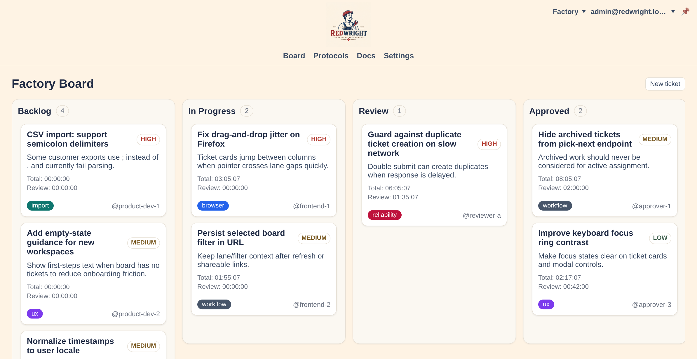

# RedWright

<!-- REDWRIGHT_LOCAL_BADGES:START -->

<!-- REDWRIGHT_LOCAL_BADGES:END -->

  

[See more](docs/reference/ui/gallery.md)

RedWright is a **black-box software factory platform** where a single runtime agent operates directly from a Kanban board. Telegram and a local TUI serve as its current interactive interfaces. The agent reads the board state, determines which ticket to execute next, and can create new tickets when incoming work isn't yet represented on the board.

## Name Origin

Personal metaphors and naming associations aren't usually something we explain. It's not our favorite thing to do, but we're not dogmatic about it either.

RedWright is a playful mix: `Red` is the color of Ruby, the language used for this implementation; `Wright` evokes the idea of a craftsperson building things with care; and the initials `R` + `W` hint at the harness approach: the agent operates through simple primitives, starting with read and write.

## Software Factory

RedWright coordinates AI coding agents through a Kanban board. Each ticket defines a unit of work, its priority, and its progress. Execution happens in isolated sandboxes.

For now, a single agent handles execution. The plan is to support multiple agents with specialized roles (programmer, reviewer, merger, QA), potentially using different models.

Execution can be triggered per ticket or run continuously, picking up the next ticket by priority. Everything goes through the board. If incoming work has no ticket, one is created.

The web interface is currently the most developed part of the system. Telegram provides an additional control channel, while a minimal local TUI offers direct access to the board. More interfaces can come later.

Much of the system already works, but it's still a work in progress. The TUI is rough, the execution model is evolving, and there's plenty left to build.

## Start Here

- [RedWright User Guide](docs/how-to/user-guide/index.md)
- [Runtime Capabilities](docs/reference/runtime-capabilities.md)

## Repos

- Official: https://forge.adrianpk.com/adrianpk/redwrigh
- Codeberg: https://codeberg.org/adrianpk/redwright
- GitHub: https://github.com/adrianpk/redwright

## License

RedWright is licensed under the [Apache License, Version 2.0](LICENSE).
